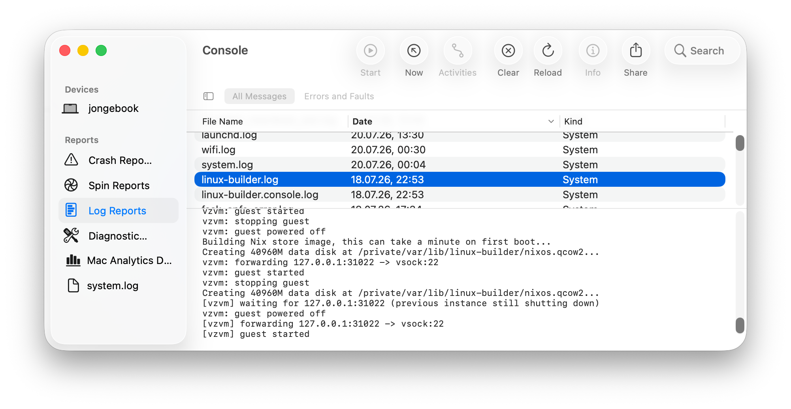

# vzvm

A minimal Linux VM monitor built on Apple's Virtualization.framework — and, on top of it,
a Nix Linux builder for macOS that can use [**Rosetta**](<https://en.wikipedia.org/wiki/Rosetta_(software)>).

It is **in nixpkgs**: In `nixos-unstable` today, and in **NixOS 26.11** when that is
released. That means it is built by Hydra and cached by `cache.nixos.org`. Turning it on is one option in your nix-darwin configuration.
There is nothing to bootstrap, no overlay to add, and no Swift to compile.

```nix
nix.linux-builder.enable = true;
nix.linux-builder.package = pkgs.darwin.linux-builder-vz;
```

`pkgs.darwin.linux-builder-vz` is the builder — the guest, the modules and the runner
wired together. The bare VM monitor is `pkgs.vzvm`, and you can drive it yourself, but be
warned that it is highly specialized for use as linux-builder: see
[Running your own guest](#running-your-own-guest).

## Why it exists

Nix on macOS cannot build Linux derivations (without cross-compilation). The standard answer is [nix-darwin's](https://github.com/nix-darwin/nix-darwin?tab=readme-ov-file#readme)
[`nix.linux-builder`](https://github.com/nix-darwin/nix-darwin?tab=readme-ov-file#readme): a small NixOS guest that runs under [QEMU](https://www.qemu.org/) and is registered as a [remote builder](https://nix.dev/manual/nix/2.18/advanced-topics/distributed-builds). It works, and for `aarch64-linux` it works well.

The gap is `x86_64-linux`. Stock `nix.linux-builder` does not build it **at all**: It sets
no [`boot.binfmt.*`](https://search.nixos.org/options?channel=26.05&query=binfmt&type=options#show=option%253Aboot.binfmt.emulatedSystems) and no `extra-platforms`. You can opt in, but then those builds run under
[qemu-user's TCG](https://www.qemu.org/docs/master/devel/index-tcg.html): software emulation, instruction by instruction. QEMU on macOS cannot reach
Rosetta. [Virtualization.framework](https://developer.apple.com/documentation/virtualization) can hand Rosetta straight to the guest, which is the
reason a second backend is worth having — a capability difference first, a speed difference
second.

What that buys, measured on the same machine with identical resources (see
[Benchmarks](#benchmarks)):

- **Rosetta.** `x86_64-linux` builds are **2.54x faster** than QEMU with
  `boot.binfmt.emulatedSystems`, and work out of the box rather than after an opt-in.
- **The guest is the closure.** Direct kernel boot plus a host-built erofs store image
  cached by closure hash — no image format, no bootloader, no `qemu-img`. Boot is faster
  (12.0s versus ~23s to a usable builder) and, more usefully, _predictable_: 10.5–13.2s
  across runs, against 0.1–31.5s.
- **Nested virtualization.** `virtualisation.vz.nestedVirtualization` boots the guest at [EL2](https://support.arm.com/documentation/102142/0100/Nested-virtualization)
  so it has a working `/dev/kvm`, which is what lets a Mac run `nixosTests` and
  `testers.runNixOSTest`. The QEMU builder cannot offer this at all. See
  [Run NixOS Integration Tests on macOS](https://nixcademy.com/posts/running-nixos-integration-tests-on-macos/).
- **Small.** Under 1000 lines of Swift against Foundation and Virtualization, nothing else;
  ad-hoc codesigned, no SwiftPM lockfile machinery. The host closure is ~1.2 GiB against
  ~3.2 GiB, with no QEMU in it.
- **macOS-native logging.** Diagnostics and the guest console go to unified logging under
  `systems.applicative.vzvm` — see [Logs](#logs).

Native `aarch64-linux` throughput comparable to the original builder's throughput. Both backends are aarch64 guests, so that is
expected. The main win is Rosetta, `/dev/kvm`, and operational fit, not raw hypervisor speed.

## Enable it

Requirements: an `aarch64-darwin` host, macOS 13 or newer, Rosetta
(`softwareupdate --install-rosetta --agree-to-license`), and a nixpkgs that contains
[#544193](https://github.com/NixOS/nixpkgs/pull/544193). That means `nixos-unstable` today,
or NixOS 26.11 once it is out. It is not in 26.05 or earlier.

```nix
{ pkgs, ... }:
{
  nix.linux-builder = {
    enable = true;
    package = pkgs.darwin.linux-builder-vz;

    # Required for Rosetta. Without x86_64-linux the builder never advertises it,
    # and Rosetta — the entire point of this backend — goes unused.
    systems = [
      "aarch64-linux"
      "x86_64-linux"
    ];
  };
}
```

Then `darwin-rebuild switch`. That is the whole setup. `pkgs.vzvm` and the guest's NixOS
closure both substitute from `cache.nixos.org`, so — unlike building this from source — you
do not need a working Linux builder to get one. Only the guest's top-level system derivation
is specific to your configuration, and even that is cheap.

Everything else about `nix.linux-builder` behaves as before: `maxJobs`, `ephemeral`,
`workingDirectory`, `config`, port 31022, the committed host key.

To let the builder run NixOS integration tests, enable nested virtualization and advertise
the features (needs macOS 15+ and an M3 or newer chip):

```nix
nix.linux-builder = {
  config.virtualisation.vz.nestedVirtualization = true;
  supportedFeatures = [
    "kvm"
    "benchmark"
    "big-parallel"
    "nixos-test"
  ];
};
```

New to Nix on macOS? [Setting up Nix on macOS](https://nixcademy.com/posts/nix-on-macos/) and
[Build and Deploy Linux Systems from macOS](https://nixcademy.com/posts/macos-linux-builder/)
cover the background this section assumes.

### Verify

```
# The daemon is running
sudo launchctl list | grep linux-builder

# The guest answers on the port nix-darwin expects
ssh -p 31022 -i /etc/nix/builder_ed25519 builder@127.0.0.1 uname -m     # aarch64

# Rosetta is wired up inside the guest
ssh -p 31022 -i /etc/nix/builder_ed25519 builder@127.0.0.1 \
  'ls /proc/sys/fs/binfmt_misc/rosetta && mount | grep rosetta'

# A native build
nix build --impure --expr \
  '(import <nixpkgs> { system = "aarch64-linux"; }).hello' --no-link

# The one that matters: x86_64 through Rosetta. This should take seconds.
nix build --impure --expr \
  '(import <nixpkgs> { system = "x86_64-linux"; }).hello' --no-link
```

If the last command finishes in seconds rather than minutes, Rosetta is doing its job.

## Migrating from the QEMU builder

Switching an existing machine over is the one-line change above plus one cleanup step.

**Delete the old builder's data disk first**, unless `nix.linux-builder.ephemeral` is set:

```
sudo rm -f /var/lib/linux-builder/nixos.qcow2
```

The vz backend has to reuse that filename — `ephemeral` deletes exactly
`${workingDirectory}/${hostName}.qcow2` — but writes a raw image there. It checks the magic
bytes and refuses a genuine leftover qcow2 rather than misreading it. With `ephemeral = true`
the launchd job deletes the file before every start anyway.

**This is not circular**, even though the new guest is itself an `aarch64-linux` closure.
`darwin-rebuild switch` realises the entire new system closure _before_ activating anything,
and the old QEMU builder is still running throughout. Only once the build has succeeded does
activation stop it and start the replacement. In practice most of that closure now comes
from the binary cache regardless.

**The first start is slower than later ones.** The runner builds a read-only erofs image of
the guest's store — roughly a gigabyte, a minute or so — and creates the data disk. The image
is cached in the working directory under a name derived from the closure's hash, so
subsequent starts reuse it and the VM is up in well under a minute. It is rebuilt only when
the guest system changes; stale ones are removed automatically.

**Nothing on the Nix side changes.** The host still listens on port 31022, the guest still
presents the same committed host key, so `/etc/nix/machines` and `known_hosts` need no edits.
Only the transport behind that port changes, from TCP forwarding to vsock.

**Rolling back is one line** — `nix.linux-builder.package = pkgs.darwin.linux-builder;`, or
just drop it. `pkgs.darwin.linux-builder` is untouched by any of this.

**What persists:** the guest's writable store lives on the data disk and survives restarts,
unless `ephemeral` is set, in which case the guest starts with an empty writable store every
time — the same behaviour as the QEMU builder. The cached store image is not affected by
`ephemeral`; it is derived from the guest system, not from anything the guest wrote.

## Benchmarks

vzvm versus `darwin.linux-builder` with `boot.binfmt.emulatedSystems = [ "x86_64-linux" ]` —
an aarch64 guest under HVF where only the x86 translation layer (Rosetta vs qemu-user TCG)
differs. Both at 8 vCPUs / 8 GiB / 40 GiB. Ratios are the geometric mean of ABBA-paired
runs with a bootstrap 95% CI; >1.00x means vzvm is faster. Full methodology and raw results
are in [`bench/`](bench/).

**`x86_64-linux` compile — the axis the project exists for.**

| Workload |   N | QEMU        | vzvm       | Ratio     | 95% CI    |
| -------- | --: | ----------- | ---------- | --------- | --------- |
| `zstd`   |   7 | 188.1s ±6.1 | 74.9s ±2.3 | **2.54x** | 2.50–2.58 |

**`aarch64-linux` compile — the control.** Both are aarch64 guests under HVF, so no
translation is involved; this is the noise floor the number above has to clear.

| Workload  |   N | QEMU         | vzvm         | Ratio | 95% CI    |
| --------- | --: | ------------ | ------------ | ----- | --------- |
| `zstd`    |   7 | 20.6s ±0.2   | 19.8s ±0.9   | 1.02x | 0.99–1.05 |
| `zstd`    |   2 | 18.2s ±0.0   | 17.6s ±1.6   | 1.04x | 1.01–1.07 |
| `openssl` |   3 | 376.7s ±3.6  | 405.8s ±1.6  | 0.93x | 0.92–0.93 |
| `git`     |   3 | 139.8s ±14.9 | 118.9s ±13.4 | 1.14x | 1.05–1.26 |

**Everything else**, aggregated across all sessions.

| Axis                        | Workload           | Arch          |   N | QEMU      | vzvm      | Ratio    |
| --------------------------- | ------------------ | ------------- | --: | --------- | --------- | -------- |
| **Many small derivations**  | 300 trivial builds | aarch64-linux |   4 | 3.9s ±0.3 | 3.4s ±0.2 | 1.15x    |
| **Closure copy to host**    | `zstd` outputs     | both          |   7 | 0.3–0.4s  | 0.3–0.4s  | ~1.00x   |
| **Boot to usable SSH**      | —                  | both          |  28 | 22.7s     | 12.0s     | **1.9x** |
| **Per-SSH-connection cost** | 20 sequential      | both          |  28 | 77 ms     | 73 ms     | ~1.00x   |

**Reading these honestly:**

- **The comparator is QEMU _plus_ binfmt.** Stock `darwin.linux-builder` cannot build
  `x86_64-linux` at all, which would produce a far more dramatic number by changing two
  variables at once. `bench/subjects.nix` deliberately gives the QEMU subject
  `boot.binfmt.emulatedSystems` so that only the translation layer differs.
- The `x86_64-linux` headline rests on **one workload**. `zstd` is compile-bound C, Rosetta's
  best case. That `openssl` inverts the result on the control axis (vzvm 7% slower — a real
  effect, likely its process-creation path, not investigated) is reason to expect the x86
  ratio to be workload-dependent too. `ffmpeg`, heavy on x86 SIMD Rosetta covers poorly, is
  untested.
- **The boot-time win is partly a caching fix, not a hypervisor fix.** vzvm caches its store
  image across starts while upstream rebuilds every start. That is an upstream design cost,
  not a QEMU cost; a QEMU backend with the same caching would close most of the gap.
- **Substitution is excluded** — dependencies are pre-warmed, so these are pure compute.
  Fetching many small paths, often the dominant real-world cost, is not measured here.
- **No native x86_64 reference**; this setup cannot produce one.
- One machine: Apple M3 Pro (12-core, 36 GiB), macOS 26.5.1 (25F80), Nix 2.35.1, nixpkgs
  `61b7c44c`, vzvm `2153cf87`/`ca90e85d`. Rosetta, Virtualization.framework and QEMU's TCG
  all move between releases.

## Design

- **Configured by a JSON file**, not CLI flags — kernel command lines and store paths are
  painful to escape through comma-separated flags. The config is generated by a Nix module.
- **Direct kernel boot** (`VZLinuxBootLoader`); no bootloader, ESP or disk image, the guest
  is the NixOS closure itself.
- **NAT networking** (`VZNATNetworkDeviceAttachment`), the one attachment needing no special
  macOS entitlement. DHCP and DNS come from macOS.
- **Inbound over vsock** — addressed by port alone, so the tool accepts loopback TCP and
  splices each connection to the guest. No gvproxy, no guest IP discovery.
- **Zero external dependencies** (Foundation + Virtualization), so nixpkgs packaging needs no
  SwiftPM lockfile machinery.

## Running your own guest

```
vzvm vm.json
```

The configuration file is the entire interface; there are no flags. Any other argument list
prints the version and usage text and exits non-zero.

`pkgs.vzvm` is a normal package and nothing stops you pointing it at your own kernel and
initrd. Be warned, though, that it is **highly specialized for the Linux-builder use case**.
There is no display or GUI, no cloud-init or image import, no snapshots, no bridged or
`vmnet` networking, no inbound path except loopback TCP spliced to vsock, and the kernel has
to be an uncompressed arm64 `Image`. If your guest does not look almost exactly like a Nix
remote builder, one of the general-purpose [VM runners](#vm-runners) — vfkit, Lima, UTM —
will be simpler to use and far better documented for it.

## Configuration

```json
{
  "cpuCount": 6,
  "memorySizeMiB": 8192,
  "kernel": "/nix/store/.../Image",
  "initrd": "/nix/store/.../initrd",
  "cmdline": "console=hvc0 init=/nix/store/.../init regInfo=/nix/.ro-store/.../registration",

  "disks": [
    { "path": "/var/lib/builder/store.img", "readOnly": true },
    { "path": "/var/lib/builder/nixos.qcow2", "readOnly": false }
  ],

  "shares": [{ "tag": "keys", "path": "/var/lib/builder/keys" }],

  "rosetta": true,
  "nestedVirtualization": false,
  "vsock": { "forwards": [{ "listen": "127.0.0.1:31022", "vsockPort": 22 }] },
  "console": { "mode": "stdio" }
}
```

`cpuCount`, `memorySizeMiB`, `kernel`, `initrd` and `cmdline` are required; the rest default.
Unknown keys are rejected rather than ignored, so a typo in the generating module fails
loudly. The schema is deliberately no larger than what the module emits — networking is
always NAT, Rosetta always shared under the tag `rosetta`, shared directories always
writable.

Notes:

- `disks` map positionally onto `/dev/vda`, `/dev/vdb`, ... Order is significant.
- A disk whose _contents_ are a QEMU qcow2 is rejected — the check reads magic bytes, not the
  name. The `.qcow2` path above is a raw disk keeping that filename because nix-darwin's
  `ephemeral` expects it; this catches genuine leftovers from `darwin.linux-builder`.
- `rosetta` startup fails with instructions if Rosetta is missing; it never silently drops
  `x86_64-linux`. `rosetta.caching` needs macOS 14+.
- The kernel must be an uncompressed arm64 `Image`; asserted at startup.
- `console.mode` is `stdio`, `file` (needs `console.path`), or `log` for unified logging (see
  [Logs](#logs)). The builder profile defaults to `log`.
- `nestedVirtualization` boots the guest at EL2, giving it a working `/dev/kvm`. Needs
  macOS 15+ and an M3 or newer chip; startup fails with a clear message otherwise. From
  NixOS it is `virtualisation.vz.nestedVirtualization` — see [Enable it](#enable-it) for the
  builder wiring.

## Logs

vzvm's diagnostics, and the guest console when `console.mode` is `log`, go to macOS unified
logging under subsystem `systems.applicative.vzvm`, split into categories `vzvm` (the
monitor) and `guest` (the VM console).

Use the absolute path — zsh's `log` builtin shadows the system tool:

```
# live, the journalctl -f equivalent
/usr/bin/log stream --predicate 'subsystem == "systems.applicative.vzvm"'

# last hour; narrow to the guest with: AND category == "guest"
/usr/bin/log show --last 1h --predicate 'subsystem == "systems.applicative.vzvm"'
```

Console.app shows the same stream (search `systems.applicative.vzvm` under the Mac in
_Devices_), and lists `linux-builder.log` / `linux-builder.console.log` under _Log Reports_,
which launchd writes:



One caveat: **unified logging rate-limits and drops under bursts** — exactly when a guest is
failing loudly. For a complete post-mortem record, send the console to a file instead; that
file, in `nix.linux-builder.workingDirectory`, is the one to trust:

```nix
nix.linux-builder.config = {
  virtualisation.vz.console = "file";
  virtualisation.vz.consoleLog = "./console.log";
};
```

## Exit codes

| Code | Meaning                                                            |
| ---- | ------------------------------------------------------------------ |
| 0    | guest powered off cleanly                                          |
| 64   | usage error                                                        |
| 69   | preflight failure (missing Rosetta, bad kernel, missing file)      |
| 70   | runtime failure (could not bind a forwarded port, could not start) |
| 71   | guest stopped with an error                                        |
| 78   | configuration error                                                |

A malformed `vsock.forwards` listen address is reported as 70, not 78 — it is only detected
once the proxies start, after preflight.

## Troubleshooting

**`preflight: Rosetta is not installed`**
Run `softwareupdate --install-rosetta --agree-to-license`. The builder refuses to start
rather than silently losing the ability to build `x86_64-linux`.

**`preflight: ... is a QEMU qcow2 image, not a raw disk`**
The migration cleanup, skipped:

```
sudo rm -f /var/lib/linux-builder/nixos.qcow2
sudo launchctl kickstart -k system/org.nixos.linux-builder
```

**`cannot listen on 127.0.0.1:31022: Address already in use`**
Another builder VM is still running — usually the old QEMU one, if a switch half failed.
`sudo launchctl bootout system/org.nixos.linux-builder`, confirm no `qemu-system-aarch64`
process remains, then `sudo launchctl kickstart -k system/org.nixos.linux-builder`.

**The daemon restarts in a loop**
`KeepAlive` is set, so a failing VM is restarted forever. The reason is on the first line of
the launchd log, and the [exit code](#exit-codes) distinguishes the cause.

**Builds compile from source instead of downloading**
The guest serves SSH only once `network-online.target` is reached, precisely so this does not
happen. If it still does, the guest has no route to `cache.nixos.org`; check from inside with
`ssh -p 31022 -i /etc/nix/builder_ed25519 builder@127.0.0.1 'curl -sI https://cache.nixos.org/nix-cache-info'`.

**`nix.linux-builder.config` changes do not take effect**
Changing the guest configuration changes the closure, so the store image is rebuilt on the
next start — the first start after such a change is slow again.

## Life after drop-in compatibility

vzvm is deliberately a _substitution_ for the QEMU builder: same option, same port, same host
key, one line to switch either way. That constraint is what made it adoptable, and every
seam it creates is a compromise. If a vz-style backend were the standard and the QEMU one
retired, these could go:

| Constraint today                                                                    | Why it exists                                                                          | What it could be                                                                                                                                            |
| ----------------------------------------------------------------------------------- | -------------------------------------------------------------------------------------- | ----------------------------------------------------------------------------------------------------------------------------------------------------------- |
| The guest runs `sshd`, and nixpkgs ships a committed host key and `builder_ed25519` | nix-darwin writes `nix.buildMachines` as `ssh-ng` to an ssh host                       | The guest serves `nix-daemon --stdio` straight off a vsock port. No sshd, no keys, no `known_hosts`, and no SSH handshake per derivation (~73 ms, measured) |
| A loopback TCP listener on `127.0.0.1:31022`                                        | Nix has to reach the builder as an ssh host                                            | Nothing listens on the host at all — vsock is addressed by port alone. No port conflicts, nothing bound                                                     |
| The data disk is a raw image named `nixos.qcow2`, and vzvm sniffs qcow2 magic bytes | `ephemeral` deletes exactly `${workingDirectory}/${hostName}.qcow2`                    | Honest filenames (`store.img`, `data.img`) and no magic-byte check                                                                                          |
| The backend is chosen by `nix.linux-builder.package`                                | It is the only seam nix-darwin offers                                                  | A declarative `backend = "vz";` with real assertions — today nothing checks the host is `aarch64-darwin` until the VM refuses to start                      |
| `virtualisation.darwin-builder.*` and an option tree shaped around `qemu-vm.nix`    | The builder profile is vendored near-verbatim so the upstream diff reads as a refactor | One coherent `virtualisation.vz` option set, with guest resources described once                                                                            |
| launchd keeps the VM resident via `KeepAlive`, idle or not                          | That is how the QEMU builder behaves                                                   | Start the guest on the first connection, stop it after an idle timeout — only possible once the transport is ours                                           |
| Exactly one guest                                                                   | `nix.linux-builder` models one builder                                                 | Several — a nested-virt one for `nixosTests` beside a plain one — or per-project ephemeral guests                                                           |

The first row has been prototyped, and it is worth recording that the obvious approach does
**not** work. A `unix://` machine URI is Nix's `UDSRemoteStore`, a `LocalFSStore` that
assumes the socket is local and reads bulk store data from the _host's_ filesystem: queries
and builds forward correctly over the protocol, and then copying outputs back fails against
the host's own store. The transport that does work is
`ssh-ng://localhost?remote-program=<bridge>` — `ssh-ng` is a pure remote store that streams
everything over the wire, and the `localhost` authority engages `fakeSSH` in Nix's
`SSHMaster`, so Nix execs the bridge directly instead of spawning `ssh`. So dropping sshd is
achievable today, but not cleanly; doing it properly wants a change on the Nix side.

One thing deliberately _not_ on that list: sharing the host's `/nix/store` into the guest
over virtiofs to avoid copying closures. That is not drop-in debt. A shared store exposes the
host's build lockfiles to the guest and deadlocks — the reasoning is carried verbatim from
upstream in the builder profile — so the vz backend always boots from a store image and has
no `useNixStoreImage` toggle at all.

## What is in this repository

**If you just want the builder, you need nothing from here.** nixpkgs carries the package and
the modules; `nix.linux-builder.package = pkgs.darwin.linux-builder-vz` is the whole
interface. This repository is where the tool is developed, and where the Nix side could be
iterated on without a nixpkgs checkout.

### `vzvm/` — the upstream source

nixpkgs' `pkgs/by-name/vz/vzvm` fetches a tagged release from here. It builds with a single
`swiftc -O -o vzvm Sources/vzvm/*.swift`: no external dependencies, so no `swiftpm2nix` and
no network fetches during the build, and it is ad-hoc codesigned with the one entitlement
`com.apple.security.virtualization`. That plainness is most of why it could be upstreamed.

| File                          | Role                                                          |
| ----------------------------- | ------------------------------------------------------------- |
| `main.swift`                  | Entry point, argument handling, VM lifecycle, signal handling |
| `Config.swift`                | The JSON schema, with unknown keys rejected; exit codes       |
| `VirtualMachineBuilder.swift` | Preflight checks and the `VZVirtualMachineConfiguration`      |
| `VsockProxy.swift`            | Splices loopback TCP connections to guest vsock               |
| `GuestConsole.swift`          | Line-buffers the guest serial console into unified logging    |
| `Log.swift`                   | `os.Logger` under `systems.applicative.vzvm`                  |

### `modules/` and `overlay.nix` — a development copy of what is now upstream

| File                                     | Upstream counterpart in nixpkgs                |
| ---------------------------------------- | ---------------------------------------------- |
| `modules/virtualisation/vm-base.nix`     | `nixos/modules/virtualisation/vm-base.nix`     |
| `modules/virtualisation/vz-vm.nix`       | `nixos/modules/virtualisation/vz-vm.nix`       |
| `modules/profiles/nix-builder.nix`       | `nixos/modules/profiles/nix-builder.nix`       |
| `modules/profiles/nix-builder-vz-vm.nix` | `nixos/modules/profiles/nix-builder-vz-vm.nix` |
| `overlay.nix`                            | `pkgs.vzvm`, `pkgs.darwin.linux-builder-vz`    |

The split into a backend-neutral profile plus one backend module exists because the module
system resolves `imports` before `config` — so the backend cannot be an option — and because
two backend modules would otherwise declare the same `virtualisation.*` options twice. That
shape is what let the nixpkgs change read as a refactor plus one new backend rather than a
rewrite. The copies here can drift from upstream; **nixpkgs is the source of truth for the
Nix side.**

### The rest

- `tests/` — `nix flake check` runs `eval-smoke` (asserts the rendered JSON), `bench-parity`
  (asserts the benchmark subjects are actually comparable), formatting, and builds of `vzvm`
  and `linux-builder-vz`. Booting needs Virtualization.framework and cannot be sandboxed, so
  only evaluation and the build are checked here.
- `bench/` — the A/B harness behind the numbers above. `nix run .#benchmark-full`.
- `nix develop` gives the Swift toolchain; `nix fmt` runs treefmt over the tree.

To run vzvm ahead of nixpkgs, add `vzvm.url = "github:applicative-systems/vzvm"` and
`nixpkgs.overlays = [ vzvm.overlays.default ];` — the overlay provides the same `pkgs.vzvm`
and `pkgs.darwin.linux-builder-vz` attribute names. This builds Swift from source and is not
what most people want.

## Other solutions

### Nix builders on macOS

These solve the same problem. If one fits you better, use it.

| Project                      | What it is                                                                    | Relative to vzvm                                                                                     |
| ---------------------------- | ----------------------------------------------------------------------------- | ---------------------------------------------------------------------------------------------------- |
| [darwin.linux-builder]       | The QEMU-based default in nixpkgs, enabled by `nix.linux-builder`.            | vzvm is the alternative backend beside it. No `x86_64-linux` by default; with binfmt, qemu-user TCG. |
| [Determinate Nix]            | Builds Linux derivations from the daemon itself via Virtualization.framework. | Better if you are on Determinate's stack; vzvm targets stock Nix and nix-darwin.                     |
| [nix-rosetta-builder]        | Lima-driven NixOS builder with Rosetta.                                       | Boots an EFI image and pins an unmerged Lima fork; vzvm boots the closure, no external VMM.          |
| [virby]                      | nix-darwin module running the builder under vfkit/krunkit, with Rosetta.      | Also image-based, reaches the guest over loopback TCP; vzvm boots a closure and uses vsock.          |
| [phaer/nixos-vm-on-macos]    | Experimental vfkit PoC: closure-direct boot plus a host-built erofs store.    | The closest prior art; vzvm differs by vsock, no external VMM, and drop-in packaging.                |
| [linuxkit-nix]               | Historical HyperKit-based builder.                                            | Deprecated by its authors in favour of `darwin.builder`; listed for completeness.                    |
| [YorikSar/nixos-vm-on-macos] | Earlier QEMU-era NixOS-on-macOS experiment.                                   | The predecessor phaer's vfkit version grew out of.                                                   |

### VM runners

Not Nix builders. Good building blocks — vzvm could have been built on vfkit — but each
leaves the guest definition, store image and builder wiring to you.

| Project        | What it is                                                                   | Relative to vzvm                                                                           |
| -------------- | ---------------------------------------------------------------------------- | ------------------------------------------------------------------------------------------ |
| [vfkit]        | Go CLI over Virtualization.framework; kernel boot, vsock and Rosetta shares. | The closest capability peer, the honest "why not this?". vzvm trades it for one binary.    |
| [Lima]         | Go VM manager with a vz driver and Rosetta, configured in YAML.              | General-purpose Linux VMs; vzvm manages only a single builder guest.                       |
| [Colima]       | Container runtimes on top of Lima.                                           | Aimed at containers, not Nix builds.                                                       |
| [microvm.nix]  | NixOS microVM framework; has a vfkit backend for macOS hosts.                | Its FAQ notes the guest needs a Linux builder — it consumes one rather than providing one. |
| [krunkit]      | libkrun-based VMM on Hypervisor.framework.                                   | A different stack; vzvm targets Virtualization.framework for Rosetta.                      |
| [Tart]         | OCI-distributed macOS/Linux VMs on Virtualization.framework, CI-oriented.    | Built around image distribution; no Nix integration.                                       |
| [UTM]          | Desktop VM app with QEMU and Virtualization.framework backends.              | Desktop-oriented; no Nix builder integration.                                              |
| [VirtualBuddy] | Desktop app focused on running macOS guests.                                 | Different guest OS focus entirely.                                                         |
| [OrbStack]     | Commercial macOS app for Docker containers and Linux VMs.                    | Closed source, not Nix-aware.                                                              |
| [macosvm]      | Minimal CLI runner for Virtualization.framework.                             | Shares the minimalism, without the Nix side.                                               |

[vfkit]: https://github.com/crc-org/vfkit
[Lima]: https://lima-vm.io/
[Colima]: https://github.com/abiosoft/colima
[microvm.nix]: https://github.com/microvm-nix/microvm.nix
[krunkit]: https://github.com/libkrun/krunkit
[Tart]: https://tart.run/
[UTM]: https://mac.getutm.app/
[VirtualBuddy]: https://github.com/insidegui/VirtualBuddy
[OrbStack]: https://orbstack.dev/
[macosvm]: https://github.com/s-u/macosvm
[nix-rosetta-builder]: https://github.com/cpick/nix-rosetta-builder
[virby]: https://github.com/quinneden/virby-nix-darwin
[phaer/nixos-vm-on-macos]: https://github.com/phaer/nixos-vm-on-macos
[YorikSar/nixos-vm-on-macos]: https://github.com/YorikSar/nixos-vm-on-macos
[linuxkit-nix]: https://github.com/nix-community/linuxkit-nix
[darwin.linux-builder]: https://nixos.org/manual/nixpkgs/stable/#sec-darwin-builder
[Determinate Nix]: https://determinate.systems/blog/changelog-determinate-nix-384/

## Further reading

- [Setting up Nix on macOS](https://nixcademy.com/posts/nix-on-macos/) — Nixcademy
- [Build and Deploy Linux Systems from macOS](https://nixcademy.com/posts/macos-linux-builder/)
  — Nixcademy; the background on `nix.linux-builder` this README assumes
- [Run NixOS Integration Tests on macOS](https://nixcademy.com/posts/running-nixos-integration-tests-on-macos/)
  — Nixcademy; pairs with `virtualisation.vz.nestedVirtualization`
- [nixpkgs#544193](https://github.com/NixOS/nixpkgs/pull/544193) — the upstreaming PR
- [Announcement on Discourse](https://discourse.nixos.org/t/drop-in-replacement-for-darwin-linux-builder-with-rosetta-support/79084)
- [The Darwin builder in the nixpkgs manual](https://nixos.org/manual/nixpkgs/stable/#sec-darwin-builder)

## Licence

MIT
